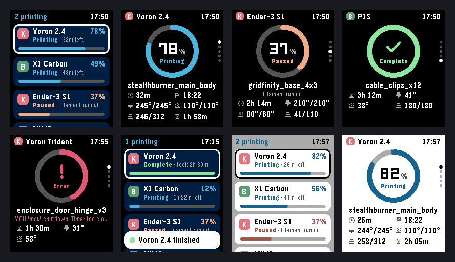
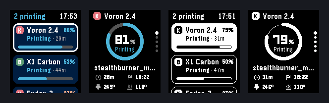

# PrintPulse

Keep an eye on all your 3D printers from a Pebble Time 2. Add Klipper, Bambu Lab and
Prusa printers from your phone, then see progress, time left, temperatures and layers at a
glance, and get a buzz when a print finishes or needs you.



## What you get

- **One list for every printer**: a card per printer with its state, time left and a progress bar.
  The header sums it all up ("2 printing", "1 needs you").
- **Detail view**: a progress ring, file name, time left, ETA, nozzle/bed temperatures, layers and
  elapsed time. Press Up/Down to flip between printers. Hold Select to pause, resume or stop a job
  (pause and stop ask for confirmation). Bambu cloud is view-only for this — use the LAN bridge to
  control Bambu printers.
- **Alerts**: the watch buzzes and shows a banner when a print finishes, fails, is cancelled, pauses or
  needs attention.
- **Check back when a print is due** (optional): PrintPulse opens briefly at the expected finish time,
  checks the printer, and tells you if the print is done. Otherwise it closes again quietly.
- **Launcher glance**: the app menu shows a live countdown, e.g. "Voron 2.4 · 1 hr 5 min left".
- **Dark and light themes**. It also runs on Pebble 2 / 2 Duo and Pebble Time (B&W and 144 px
  screens): 

## Supported printers

| Printer | How PrintPulse connects | What you need |
| --- | --- | --- |
| **Klipper** (Voron, RatRig, Ender with Klipper, …) | Moonraker API, the same one Mainsail and Fluidd use | The printer's address. API key only if Moonraker requires one |
| **Prusa** (MK4/MK4S, MK3.9, XL, MINI+, CORE One, MK3S with PrusaLink) | PrusaLink on the local network | Address and the PrusaLink password from the printer |
| **Bambu Lab**, cloud (X1, P1, A1, H2) | Your Bambu Lab account | Email and password (one-time sign-in) |
| **Bambu Lab**, LAN-only mode | `tools/bambu_bridge.py`, a small relay you run at home | Printer IP, serial number and LAN access code |

Your phone talks to the printers, so Klipper, Prusa and the Bambu bridge must be reachable from
your phone: same Wi-Fi, or over a VPN such as Tailscale. When a printer can't be reached, the last
known status stays on screen marked "seen 14:02" for up to 12 hours.

## Build and install

### 1. Build

The Pebble SDK runs on Linux and macOS only. On **Windows**, `build.ps1` runs it in a container
(install [Podman Desktop](https://podman-desktop.io) or Docker Desktop first):

```powershell
./build.ps1
```

The first run builds the container image and downloads the SDK, which takes a few minutes. The app ends up in
`build/PrintPulse.pbw`. The SDK prints Pebble's Terms of Use and Developer License on install; using
it means agreeing to them.

On **macOS/Linux**, [install the SDK](https://developer.repebble.com/sdk) and run `pebble build`.

### 2. Put it on your watch

Pick one:

- **CloudPebble** (no command line). In the Pebble app on your phone, open the **Devices** tab, tap
  your watch's three-dot menu and turn on **Dev Connection** ("Connected to CloudPebble"). In
  CloudPebble, signed in with the same Pebble account, choose **Import → Upload zip** and pick
  `dist/PrintPulse-cloudpebble.zip` (make it with `./build.ps1 -Zip`; the settings page is already
  embedded). Then open **Build & Run**, build, choose the **Phone** tab under *Run On*, pick
  **New Cloud Dev Connection** and click **Install and Run**.
- **Open the file on your phone.** Send `build/PrintPulse.pbw` to your phone (AirDrop, email,
  cloud drive…) and open it with the Pebble app.
- **Developer connection.** Turn on the developer connection in the Pebble app's settings, note the
  IP address it shows, then run:

  ```powershell
  ./build.ps1 -Phone 192.168.1.23
  ```

## Add your printers

In the Pebble app on your phone, open **PrintPulse → Settings**. Tap **+ Add printer**, pick the
brand, fill in the form and tap **Add**. Add as many as you like (up to 8), then tap
**Save to watch**. Each printer card shows whether the last check worked.

**Klipper:** enter the address you open Mainsail or Fluidd with, e.g. `192.168.1.40` or
`voron.local`. If that address doesn't answer, PrintPulse also tries Moonraker's port 7125.

**Prusa:** enter the printer's address and the PrusaLink password, found on the printer under
*Settings → Network → PrusaLink* (the username is usually `maker`). Older PrusaLink versions can use an
API key instead.

**Bambu Lab (cloud):** enter your Bambu Lab email and password and save. If Bambu emails you a
verification code, the watch will say so: open the settings again, type the code into the field that
appears and save. Only the access token is kept on your phone, never your password; it lasts about
3 months, after which the card asks you to sign in again.
- *2FA or social login (Google, Apple, Facebook):* sign in at bambulab.com in a desktop browser,
  open the developer tools, copy the value of the `token` cookie and paste it under
  "2FA or social login? Paste an access token".
- The cloud doesn't always report live progress. When it doesn't, PrintPulse estimates progress from the start
  time and the slicer's estimate and shows it with a `~` (for example `~64%`). This uses Bambu's
  unofficial cloud API, which Bambu may change at any time.

**Bambu Lab (LAN-only mode or exact numbers):** run the bridge on any always-on computer at home
(Raspberry Pi, NAS, PC). You'll find the serial number and LAN access code on the printer's screen.

```bash
pip install paho-mqtt
python tools/bambu_bridge.py --printer "X1C,192.168.1.50,01S00C000000000,12345678"
```

Repeat `--printer` for more printers, or list them in a JSON file and pass `--config`.
Then add **Bambu Lab → LAN bridge** with the address `http://<that computer's IP>:8787`. To require a
shared secret, start the bridge with `--token something` and enter the same token in PrintPulse.

**Watch options:** how often to refresh (15 s to 2 min, only while the app is open), theme,
buzzing, "check back when a print is due", and demo printers to try the app without hardware.

## On the watch

| Where | Button | Does |
| --- | --- | --- |
| List | Up / Down | Move between printers |
| List | Select | Open the printer |
| List | Hold Select, or the **Refresh** row | Refresh now |
| Detail | Up / Down | Previous / next printer |
| Detail | Select | Refresh now |

Colours: **blue** printing, **yellow** paused, **orange** needs attention, **green** done,
**red** error, **grey** idle or offline. A phone icon with a slash in the header means the watch has
lost contact with your phone.

Pebble apps can't run in the background, so printers are checked while PrintPulse is open, plus the
optional check at the expected finish time. That check gives up after three tries with nothing new,
so a slipping estimate won't keep waking your watch.

## Releases / version check

Follow [`.deploysteps`](.deploysteps). Short version:

```powershell
./build.ps1 -Login                                          # once per machine
./build.ps1 -Publish -ReleaseNotes "What changed for users"
```

That builds the `.pbw` and publishes to the Pebble appstore with
[`store/listing.json`](store/listing.json) and [`store/screenshots/`](store/screenshots)
(CloudPebble is not required). Then bump and push [`version.json`](version.json) on `main` so
already-installed copies show the update banner.

On launch, the phone side fetches `version.json`. If that version is newer than the installed app,
the watch shows a one-time toast and Settings shows a dismissible banner. Dismissing remembers that
version until a newer one appears. Keep `package.json`, `src/pkjs/version.js` (`APP_VERSION`), and
`version.json` on the same NEW version when you ship.

## Development

```
src/c/            watch app (C)
  main.c          lifecycle, alerts, wake-ups, launcher glance
  model.*         printer records, persistence, state changes
  comm.*          AppMessage protocol
  win_list.c      printer list; win_detail.c: detail view
  draw.* theme.* ui.*   drawing helpers, colours, header, toast
src/pkjs/         phone side (JS)
  index.js        polling loop, message queue, settings page plumbing
  version.js      GitHub version check + dismiss state
  klipper.js prusa.js bambu.js demo.js   one module per printer type
  http.js md5.js  XHR wrapper with HTTP digest auth (PrusaLink)
  store.js        settings and secrets in the phone's localStorage
config/index.html settings page; wscript embeds it into the JS bundle at build time
store/            appstore listing text + screenshots for `pebble publish`
version.json      latest published version (checked by installed apps)
tools/bambu_bridge.py   Bambu LAN bridge
build-env/        container image used by build.ps1 (includes publish.py)
.deploysteps      release checklist (bump → publish → GitHub)
```

`./build.ps1 -Shell` opens a shell with the `pebble` tool. The emulator runs headless there, so use
`--vnc` and take screenshots:

```bash
pebble install --emulator emery --vnc
pebble screenshot --emulator emery --vnc --no-open shot.png
pebble emu-button --emulator emery --vnc click down
```

The emulator shows demo printers until you configure it.

Note for contributors: don't use `GTextOverflowModeTrailingEllipsis` or `GTextOverflowModeFill`.
Truncating text with them can hang the current PebbleOS firmware (reproduced on the flint emulator).
Use `draw_text_fit()` / `draw_text_run()` from `draw.h`, which shorten text themselves.
